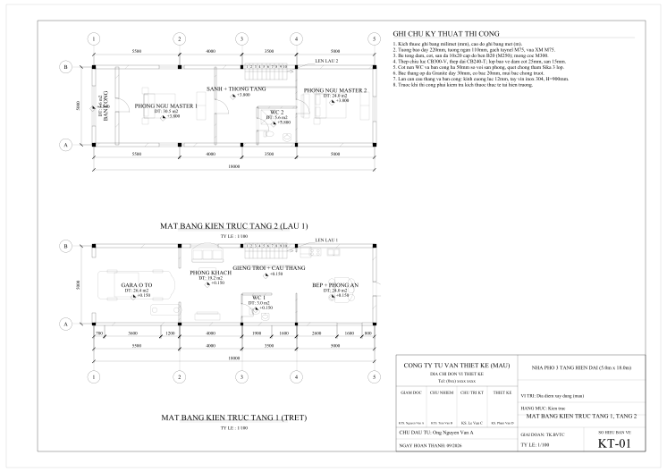
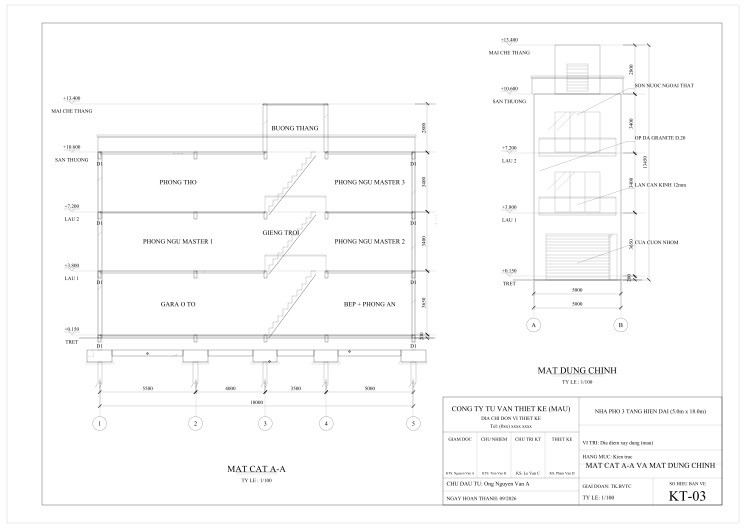
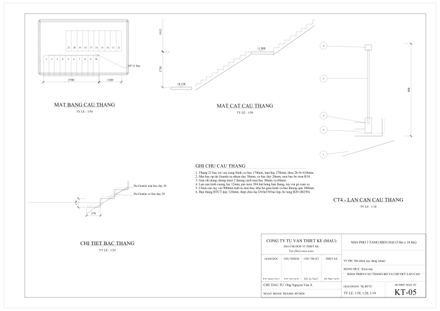

# HP Skill Autocad VN

Bộ skill cho Claude Code để dựng hồ sơ bản vẽ nhà ở Việt Nam, xuất DXF, DWG, PDF và dự toán Excel.
Bộ này do **Nguyễn Hữu Phúc** sửa đổi từ
[vn-autocad-skill](https://github.com/andyluu98/vn-autocad-skill) của andyluu98, theo giấy phép
Apache 2.0, để khớp quy định làm việc riêng.

| | | |
|---|---|---|
|  |  |  |
| KT-01 Mặt bằng tầng 1, tầng 2 | KT-03 Mặt cắt A-A, mặt đứng | KT-05 Cầu thang, lan can |

Ảnh trên chụp từ bản gốc, chưa có nhãn khung tên tạm của bản này.

## Khác gì bản gốc

| Mục | Bản gốc | Bản này |
|---|---|---|
| Tỷ lệ mặt bằng | 1/100 | 1/50 cho dự án mới; bộ mẫu nhà 18m giữ 1/100 |
| Dự toán | Không có cột diễn giải, tỷ lệ chi phí viết trong công thức | Có cột diễn giải và phần trừ, tỷ lệ trong ô riêng, bắt buộc nhập |
| Khối lượng | Theo số truyền vào | Làm tròn 2 số lẻ |
| Khung tên | Khung mẫu | Khung tạm, in nhãn chưa duyệt |
| Số liệu tham khảo | Dùng trực tiếp | Đánh dấu "cần kiểm tra", không làm mặc định |

Chi tiết: [quy định riêng](skills/hp-quy-trinh-ho-so/references/quy-dinh-rieng.md),
[nhật ký thay đổi](CHANGELOG.md).

## Thành phần

| Skill | Phụ trách |
|---|---|
| `hp-quy-trinh-ho-so` | Điều phối 11 bước, điểm kiểm tra, bàn giao |
| `hp-kien-truc` | Mặt bằng, mặt đứng, mặt cắt, khai triển, lát gạch, trần, chống thấm |
| `hp-ket-cau` | Móng, dầm sàn, chi tiết thép, bảng thống kê thép |
| `hp-co-dien` | Điện nước, sơ đồ nguyên lý, bảng ký hiệu |
| `hp-bo-cuc-to-giay` | Lưới ô trong Model, Layout A3, Viewport nhiều tỷ lệ |
| `hp-soat-ban-ve` | Soát tự động, bằng mắt và kỹ thuật |
| `hp-du-toan` | Dự toán Excel lấy khối lượng từ bản vẽ |
| `hp-xuat-autocad` | Chuyển DXF sang DWG, xuất PDF |

Kèm 5 agent, 3 lệnh (`/ho-so-moi`, `/soat-ban-ve`, `/xuat-dwg`), 4 công cụ trong `tools/`, thư viện
Python `hpcad` và bộ mẫu `examples/nha_pho_5x18m`.

## Cài đặt

Yêu cầu Python 3.10 trở lên và phông Times New Roman.

```bash
/plugin marketplace add HuuPhucGL/HP-Skill-Autocad-VN
/plugin install hp-skill-autocad-vn@hp-autocad
```

Dùng như thư viện Python:

```bash
pip install -e ".[test]"
python -m examples.nha_pho_5x18m.build_ho_so
pytest -q
```

## Giới hạn

- Không thay tính toán kết cấu, không thay chữ ký của người có chứng chỉ hành nghề.
- Thư viện chưa tạo Text style và Dim style Annotative.
- Chưa có file mẫu `.dwt`, khung tên, CTB, định mức và đơn giá riêng.
- Tên layer chưa đối chiếu TCVN; mã hiệu công tác chưa đối chiếu định mức.
- Bộ soát chưa đọc chữ trong kích thước và chữ trên giấy; vẫn phải nhìn ảnh.

## Giấy phép

[Apache License 2.0](LICENSE). Ghi công và thông báo sửa đổi: [NOTICE](NOTICE).
